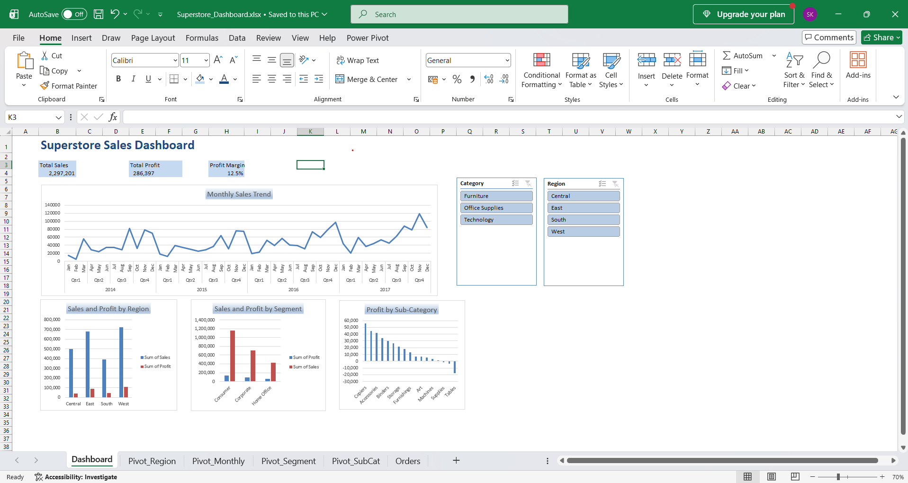

# Superstore Sales Analysis (SQL + Excel)

## Problem
Identify which regions, segments and products drive profit, and where
discounting is hurting the business.

## Tools
MySQL (aggregations, CTEs, window functions), Excel (pivot tables, slicers, dashboard)

## Approach
1. Loaded ~10K orders (2014-2017) into MySQL and cleaned inconsistent date formats
2. Wrote 5 analytical queries: region, top products, monthly trend (LAG window function), loss-making sub-categories, customer segments
3. Built an interactive Excel dashboard with pivot charts and slicers

## Key Insights
- West has the highest margin (14.9%); Central sells more than South but has the lowest margin (7.9%).
- Tables, Bookcases and Supplies are loss-making. Tables and Bookcases carry average discounts above 20%, pointing to discounting as a likely driver; Supplies loses money at a low discount, suggesting a cost or pricing issue.
- Sales peak in September, November and December every year, and grew about 29% in 2016 and 20% in 2017.
- Consumer is the largest segment but has the lowest margin (11.6%); Home Office is the smallest but the most profitable per dollar (14.0%).

## Dashboard

